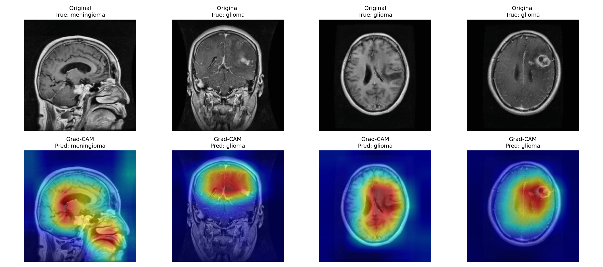
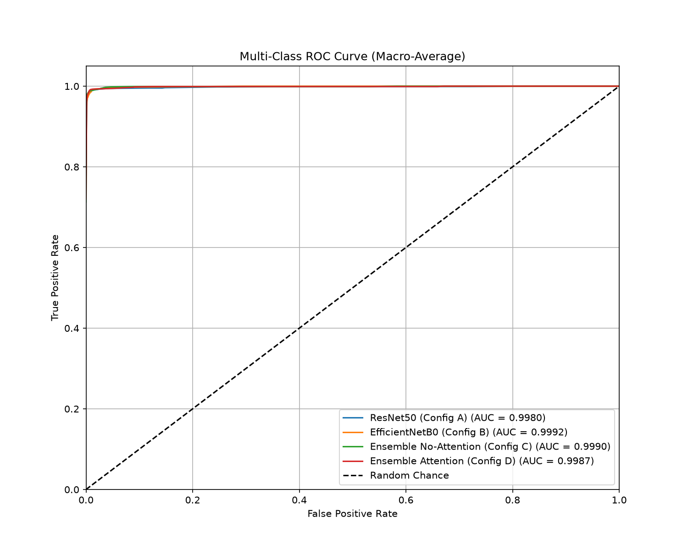

# 🧠 Brain MRI Classification & Explainability System

A deep learning framework designed to classify brain MRI images into four diagnostic categories: **Glioma, Meningioma, Pituitary Tumor, and No Tumor**. 

This project was developed as a research-oriented decision-support tool, implementing Multi-Stage Transfer Learning, Ensemble Learning, Attention Mechanisms, and Explainable AI (Grad-CAM).

## 📌 Features

*   **Image Preprocessing**: Uses Contrast Limited Adaptive Histogram Equalization (CLAHE) to enhance local contrast and tumor boundaries before feeding images into the models.
*   **Base Architectures**: Fine-tuned **ResNet50** and **EfficientNetB0** using a 3-stage Multi-Stage Transfer Learning (MSTL) strategy.
*   **Feature-Level Ensemble**: Fuses the deep features from both ResNet50 and EfficientNetB0 to improve classification robustness.
*   **Attention Mechanism**: A self-attention block applied to the fused features to refine the most important spatial patterns.
*   **Explainability (Grad-CAM)**: Generates Grad-CAM heatmaps to visualize which parts of the brain the model is focusing on when making a decision.

## 📊 Experimental Results

The models were trained on a dataset of **7,200 MRI images** (split 70% Train, 15% Validation, 15% Test). 

| Model Configuration | Test Accuracy | AUC-ROC | F1-Score |
| :--- | :--- | :--- | :--- |
| **ResNet50 (Baseline)** | 98.24% | 0.9980 | 0.9824 |
| **EfficientNetB0 (Baseline)** | 98.33% | 0.9992 | 0.9833 |
| **Ensemble (No Attention)** | 98.52% | 0.9990 | 0.9852 |
| **Ensemble (With Attention)** | 98.43% | 0.9987 | 0.9843 |

*Note: While all models performed exceptionally well, the standalone EfficientNetB0 achieved the highest overall AUC-ROC.*

## 📂 Project Structure

*   `dataset.py` - PyTorch Dataset class handling CLAHE, resizing, and normalization.
*   `create_splits.py` - Script to generate stratified 70/15/15 train/val/test splits.
*   `train_resnet.py` & `train_efficientnet.py` - Training loops implementing Multi-Stage Transfer Learning.
*   `train_ensemble.py` - Code for feature fusion and attention mechanisms.
*   `evaluate_final.py` - Script to generate classification reports, confusion matrices, and ROC curves.
*   `grad_cam.py` - Generates heatmap overlays for explainability.
*   `main.py` - *(Coming Soon)* FastAPI backend for the web interface.

## 🖼️ Visualizations

### Grad-CAM (Explainable AI)
*(The model successfully identifies the tumor region rather than relying on background artifacts)*

### Multi-Class ROC Curves
*(All models demonstrate near-perfect classification capability)*

## ⚠️ Known Limitations (Domain Shift)

During external validation, it was observed that the model struggles with "Domain Shift". If tested on MRI images from the internet that have different contrast settings (e.g., Post-gadolinium), different resolutions, or text/arrows drawn on them, the model may fail. This highlights the necessity of fine-tuning clinical models on local hospital data before deployment.

## 🛠️ Technologies Used
*   **Deep Learning**: PyTorch, Torchvision
*   **Image Processing**: OpenCV, Pillow
*   **Data & Metrics**: Scikit-learn, Pandas, NumPy
*   **Explainability**: PyTorch Grad-CAM
*   **Visualization**: Matplotlib, Seaborn

## 🚀 Future Work
1.  Deploy the model using FastAPI and React for an interactive clinical dashboard.
2.  Train on a larger, multi-institutional dataset to reduce Domain Shift.
3.  Implement 3D volumetric MRI analysis.
